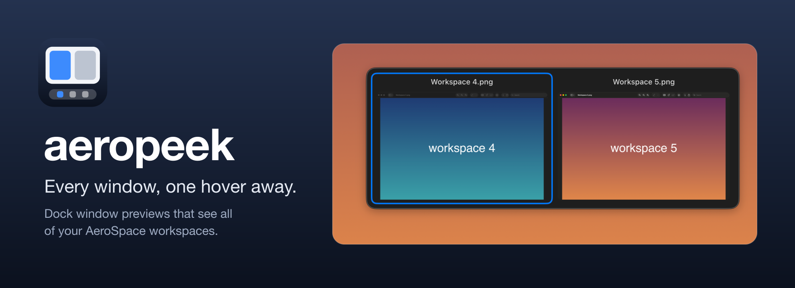
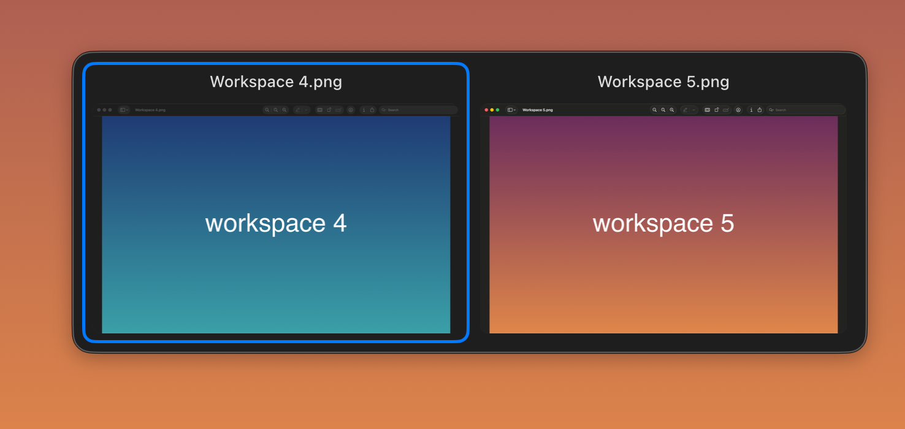

<p align="center"></p>

<p align="center">
  <a href="#install">Install</a> ·
  <a href="#what-the-panel-does">Panel</a> ·
  <a href="#what-works-where">Supported setups</a> ·
  <a href="#commands">Commands</a>
</p>

<p align="center">
  <a href="LICENSE"></a>
  
  
</p>

Dock window previews for [AeroSpace](https://github.com/nikitabobko/AeroSpace) users on macOS. Hover a Dock icon, see that app's windows from every workspace, click one to go there.

## Features

- **Sees every workspace.** AeroSpace parks the windows of hidden workspaces one pixel inside the screen corner, and the private capture call window switchers usually use returns only that sliver. aeropeek captures with ScreenCaptureKit and gets the whole window.
- **Never jumps.** The panel has one height and one vertical position, for every app and every window count. Windows are ordered by creation, so each keeps its place.
- **Fast.** The panel is up a median 1 ms after the Dock reports a hover (worst seen: 74 ms, on the first hover after launch), showing cached thumbnails; fresh captures replace them a median 68 ms after the hover (worst: 139 ms). Measured over 70 hovers on an Apple silicon MacBook Pro with 9 windows open.
- **Idle means idle.** Once it has its permissions, nothing polls. While the panel is hidden the process receives no mouse events and runs no timers.
- **Click goes through AeroSpace.** A click runs `aerospace focus --window-id`, so the workspace switch and the focus are AeroSpace's own.
- **Small.** Under 800 lines of Swift and AppKit, no dependencies.

<p align="center"></p>

<p align="center"><sub>Captured from the real app. The two windows are made-up images; the left one sits on a hidden workspace.</sub></p>

## Install via your AI agent

Paste this into Claude Code (or another coding agent):

> Install aeropeek from https://github.com/wickes1/aeropeek on this Mac. Read https://raw.githubusercontent.com/wickes1/aeropeek/main/README.md first.
> 1. Check that `aerospace --version` works. Run `defaults read com.apple.dock orientation`: `bottom`, or an error saying the key does not exist (unset means bottom), is fine. Stop and tell me if aerospace is missing or the Dock is on the `left` or `right`.
> 2. Run `brew install --cask wickes1/tap/aeropeek`, then `open -a AeroPeek`.
> 3. Tell me to turn on AeroPeek under Accessibility and under Screen & System Audio Recording in System Settings → Privacy & Security, and wait for me.
> 4. Run `pkill -x AeroPeek; sleep 1; open -a AeroPeek`.
>
> Stop and ask me if anything is ambiguous; do not guess.

## Install

Needs macOS 14 or later, AeroSpace, and a Dock at the bottom of the screen.

### Homebrew

```sh
brew install --cask wickes1/tap/aeropeek
open -a AeroPeek
```

Grant the two permissions below, then start it once more: `pkill -x AeroPeek; sleep 1; open -a AeroPeek`.

| Also | How |
|---|---|
| Start with the Mac | System Settings → General → Login Items & Extensions (Login Items on macOS 14) → add AeroPeek |
| After `brew upgrade` | nothing: Homebrew quits AeroPeek and reopens it. Run `open -a AeroPeek` only if it is not running afterwards |

AeroPeek.app is self-signed, not notarized. The cask clears the download quarantine flag after installing; without that, Gatekeeper refuses the app. A zip downloaded by hand from the releases page stays blocked, so install through Homebrew or from source.

### From source

Needs Swift 6 or later (Xcode 16 or later, or the matching Command Line Tools).

```sh
git clone https://github.com/wickes1/aeropeek && cd aeropeek
scripts/make-signing-cert.sh
scripts/build-app.sh --install
```

`scripts/make-signing-cert.sh` creates a self-signed signing identity (`aeropeek Dev`) in the login keychain, once. `scripts/build-app.sh --install` builds, signs, installs `~/Applications/AeroPeek.app` and launches it.

Never run an ad-hoc-signed build: macOS ties permission grants to the signing identity, and an ad-hoc identity changes with every build. For the same reason a source build and the Homebrew build do not share grants: run `tccutil reset All dev.wickend.aeropeek` when switching from one to the other.

### Permissions macOS will ask for

Both are under System Settings → Privacy & Security.

| Permission | Used for | Takes effect |
|---|---|---|
| Accessibility | hearing the Dock's hover events, listing windows | at once |
| Screen & System Audio Recording | capturing thumbnails | after the app is started again |

Without Screen Recording the panel still works, with grey cards in place of thumbnails.

### Uninstall

| Installed with | Remove with |
|---|---|
| Homebrew | `brew uninstall --cask aeropeek` |
| Source | `pkill -x AeroPeek; rm -rf ~/Applications/AeroPeek.app` |
| Permission entries | `tccutil reset All dev.wickend.aeropeek` |
| Signing identity of a source build | Keychain Access → login → delete `aeropeek Dev` |

## What works where

Seen working on one Mac: macOS 26, Apple silicon, AeroSpace from Homebrew, one display, an auto-hiding Dock at the bottom.

| Setup | Status |
|---|---|
| Windows on hidden AeroSpace workspaces | thumbnails and click both work |
| Auto-hiding Dock at the bottom | works; the panel follows the Dock while it slides in |
| Always-visible Dock at the bottom | written, not yet run |
| More than one display | written, not yet run |
| Intel Mac | builds as part of the universal binary; not yet run |
| AeroSpace from nix-darwin | the path is searched; not yet run |
| Dock magnification | not yet run |
| Minimised windows | not yet run |
| Dock on the left or right | refused at launch, with a message |
| No `aerospace` command in Homebrew's or nix-darwin's bin | refused at launch, with a message |

## What the panel does

| You | The panel |
|---|---|
| hover a running app's Dock icon | opens above the Dock with one thumbnail per window, the title centred above each |
| move up into it | stays; the thumbnail under the pointer gets an outline in the system accent colour |
| click a thumbnail | closes, and AeroSpace switches to that window's workspace and focuses it |
| slide to another Dock icon | shows that app's windows at the same height, centred over that icon |
| move away from the panel and the Dock | closes 0.2 s later |

Rules that hold for every panel:

- Height and vertical position never change. Only the width does, with the number of windows.
- Windows are in creation order, oldest on the left.
- A thumbnail keeps its window's shape. An app with more windows than fit gets narrower thumbnails, not a second row.
- Cached thumbnails show at once; each is replaced when its fresh capture lands.
- A window without a title shows the app's name.
- Colours follow the system's light or dark appearance. Nothing animates.
- The panel never takes the keyboard and never becomes the active app.
- An app with no windows gets no panel. Neither do the Trash, folders or apps that are not running.

## Commands

aeropeek has no menu bar item and no settings.

| Task | Command |
|---|---|
| Start | `open -a AeroPeek` |
| Quit | `pkill -x AeroPeek` |
| Read its log | `log stream --predicate 'subsystem == "dev.wickend.aeropeek"'` |
| Trace hovers and timings | `pkill -x AeroPeek; sleep 1; open -a AeroPeek --env AEROPEEK_DEBUG=1`, then read the log |

## Layout

- `Sources/AeroPeek/DockWatcher.swift` — subscribes to the Dock's accessibility notification for a change of hovered item.
- `Sources/AeroPeek/Windows.swift` — lists an app's windows through the accessibility API, off the main thread.
- `Sources/AeroPeek/AX.swift` — typed, type-checked readers over the accessibility API.
- `Sources/AeroPeek/Thumbnails.swift` — captures windows with ScreenCaptureKit at display size, concurrently, and caches them in memory.
- `Sources/AeroPeek/Layout.swift` — panel and card geometry as pure arithmetic; the only part with unit tests.
- `Sources/AeroPeek/PreviewPanel.swift` — the one reused panel, drawn with Core Animation layers.
- `Sources/AeroPeek/main.swift` — ties them together: show, hide, click.
- `packaging/aeropeek.rb.in` — Homebrew cask template.
- `Resources/AppIcon.svg` — the icon. `Resources/AppIcon.icns` is generated from it by `scripts/make-icon.sh` and committed, so a build needs neither `rsvg-convert` nor `iconutil`.
- `docs/images/` — `demo.png` is a capture of the real app showing made-up windows; `hero.png` is composed around it.

Three habits of the Dock shaped the code:

- **Its hover report goes stale.** After the pointer leaves an icon upwards the Dock still names that icon, so hiding is decided from the pointer's position, through a mouse monitor that exists only while the panel is visible.
- **Its icons move while it slides in.** A first reading of an auto-hiding Dock's top edge can be low. aeropeek keeps the highest reading per Dock size and screen, and follows the Dock until it stops; after that every panel opens in its final place.
- **It restarts.** The watcher subscribes again when the Dock relaunches.

One private call is used: `_AXUIElementGetWindow`, which maps an accessibility window to its window id. AeroSpace depends on the same call.

## Development

```sh
scripts/test.sh                  # unit tests (Swift Testing; works with Command Line Tools only)
scripts/build-app.sh --install   # rebuild, re-sign, replace the installed app, relaunch
scripts/make-icon.sh             # Resources/AppIcon.svg → Resources/AppIcon.icns (needs rsvg-convert)
scripts/release.sh               # universal build → dist/AeroPeek-<version>.zip + dist/aeropeek.rb
```

A release is the zip uploaded to a GitHub release tagged `v<version>`, plus `dist/aeropeek.rb` copied into the tap as `Casks/aeropeek.rb`. Every release must be signed with the same `aeropeek Dev` identity: the permissions users granted are tied to it.
